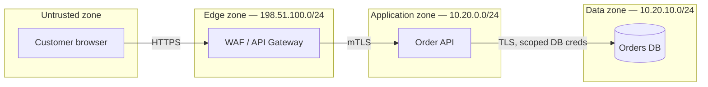
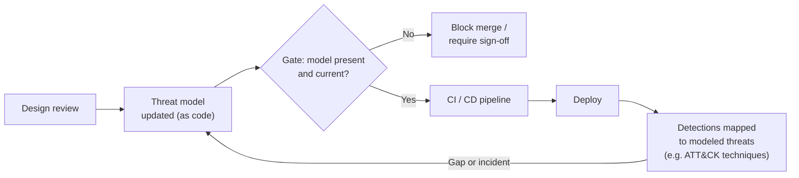

# Threat Modeling

## 1. Purpose

[Security Fundamentals](fundamentals.md) defines the properties a system is
trying to protect (confidentiality, integrity, availability, ...) and the
principles used to reason about trade-offs (least privilege, defense in
depth, zero trust, ...). Threat modeling is the practice that applies those
principles to a *specific* system, early enough to change the design: it
asks "what can go wrong here, and what are we doing about it?" before the
system is built, and again whenever it changes materially.

Used well, a threat model is a living design artifact with an owner and a
re-review trigger. Used badly, it is a diagram from a single workshop that
nobody opens again — [§5](#5-anti-patterns) covers why that failure mode is
the default outcome, not an edge case.

---

## 2. What a Threat Model Is

A threat model identifies, for a given system boundary:

1. **Trust boundaries** — where data or control crosses between zones of
   different trust (user → edge, service → service, service → data store).
2. **Threats** at each boundary, enumerated with a repeatable method rather
   than ad hoc brainstorming.
3. **Mitigations** — the control that addresses each threat, and its state
   (in place, planned, accepted).
4. **Residual risk** — what remains after mitigation, owned explicitly
   rather than left implicit.

Two methods cover most cases:

| Method | Approach | Best suited to |
| --- | --- | --- |
| **STRIDE** | Walk each trust boundary and ask whether each of six threat categories applies | Component- and data-flow-level modeling; the default for most services |
| **Attack trees** | Start from an attacker goal (e.g. "exfiltrate customer PII") and decompose into the AND/OR paths that achieve it | Modeling a specific high-value asset or a known adversary objective end-to-end |

The two are complementary, not competing: STRIDE sweeps a boundary for
threat *categories*; an attack tree traces one attacker *goal* across
several boundaries. A mature program uses STRIDE as the default sweep and
reaches for an attack tree when a specific asset (e.g. a signing key, a
tenant-isolation boundary) justifies the deeper, goal-directed analysis.

### STRIDE Categories

| Category | Violates | Example question at a boundary |
| --- | --- | --- |
| **S**poofing | Authenticity | Can a caller claim an identity it doesn't hold? |
| **T**ampering | Integrity | Can data be modified in transit or at rest without detection? |
| **R**epudiation | Non-repudiation | Can an actor deny having performed an action, for lack of evidence? |
| **I**nformation disclosure | Confidentiality | Can data cross the boundary to an unauthorized party? |
| **D**enial of service | Availability | Can the boundary be overwhelmed or starved of a resource? |
| **E**levation of privilege | Authorization | Can a caller obtain rights beyond what it was granted? |

Mapping back to the properties in [Security Fundamentals §2–§4](fundamentals.md#2-the-cia-triad):
each STRIDE category exists because it violates one of CIA, authenticity,
non-repudiation, or AAA — STRIDE is CIA-plus made operational at a diagram
boundary, not a separate theory.

---

## 3. Worked Example (Fictional)

**System:** Meridian's customer-facing order API. Example addresses are
illustrative only (RFC 5737 / RFC 1918).

| # | Boundary | STRIDE threat | Mitigation | State | Residual risk |
| --- | --- | --- | --- | --- | --- |
| 1 | Browser → WAF | Spoofing (stolen session token replayed) | Short-lived token + device-bound refresh | In place | Low — narrow replay window |
| 2 | Browser → WAF | Denial of service (request flood) | Rate limiting, WAF-layer throttling | In place | Medium — accepted up to WAF capacity limit |
| 3 | WAF → API | Elevation of privilege (gateway misroutes a scope) | mTLS + per-route scope check at API, not gateway alone | In place | Low |
| 4 | API → DB | Information disclosure (over-privileged DB credential) | Scoped service credential, least privilege per [Security Fundamentals §5](fundamentals.md#least-privilege) | Planned — ticket MER-SEC-142 | Medium until closed |
| 5 | API → DB | Repudiation (write with no attributable actor) | Structured audit log keyed on request ID | In place | Low |

This row-level table *is* the artifact that should be re-reviewed — not a
one-time diagram. See [§6](#6-scaling-threat-modeling-in-the-enterprise) for
how the re-review is triggered rather than left to memory.

---

## 4. Threat Modeling in the Lifecycle

Threat modeling is not a substitute for the vulnerability management
program covered in [Cybersecurity Architecture](../vulnerability-management/index.md)
— it complements it. A threat model reasons about design-time risk before
code exists; scanning, SAST, and pentesting find implementation-time
deviations from that design afterward. A finding from either side should be
able to update the other: a pentest result that reveals a missed trust
boundary should feed back into the threat model, not just close a ticket.

---

## 5. Anti-Patterns

These four show up repeatedly and they compound: each one makes the next
more likely.

| Anti-pattern | What it looks like | Why it fails |
| --- | --- | --- |
| **One-off workshop** | A single 2-hour session before launch, never repeated | The system drifts from the model within weeks; the model becomes a historical artifact, not a current one |
| **Diagram-only output** | A whiteboard photo or a data-flow diagram with no threats, mitigations, or residual-risk column | A diagram shows *what exists*, not *what can go wrong with it* — it looks like analysis but contains none |
| **No owner** | The model is "the team's," meaning no individual is accountable for keeping it current | Shared ownership of a maintenance task defaults to nobody's priority; the first missed re-review is never noticed |
| **No re-review trigger** | The model is updated only "when someone remembers" | Without an explicit trigger (new boundary, new data classification, significant redesign, calendar cadence), a correct model at T0 silently becomes wrong at T0+n with no signal that it happened |

> **Rule of thumb:** if a threat model has no named owner and no next
> scheduled or triggered review, treat it as already stale, regardless of
> how recently it was drawn.

---

## 6. Scaling Threat Modeling in the Enterprise

A workshop-per-system model does not scale past a handful of services.
Three mechanisms make it scale:

### Threat-Model-as-Code

Express the model (components, trust boundaries, data flows, threats) in a
structured, version-controlled format rather than a slide or a drawing tool
file, so it:

- lives in the same repo as the system it describes, and changes in the
  same pull request as the architecture change that motivated it;
- is diffable in code review — a reviewer sees *which boundary changed*,
  not just that the picture looks different;
- can be partially generated or validated by tooling rather than relying
  entirely on manual redraws.

### Templates for Common Patterns

Most new services are a known shape (REST API in front of a datastore,
event consumer on a message bus, batch job with a service credential).
A library of reusable, pre-threat-modeled component templates means a new
service starts from "here are the standard threats for this shape, confirm
or override," rather than a blank page — which is also what keeps the
output above diagram-only: the template already carries the
threat/mitigation/residual-risk columns, not just the shape.

### Explicit Re-Review Triggers

Re-review is scheduled by event, not by memory:

| Trigger | Example |
| --- | --- |
| New trust boundary | A new external integration or third-party API call is added |
| Data classification change | A field now carries PII or payment data that it didn't before |
| Significant architecture change | A new network path, a new credential type, a move from sync to async |
| Incident or pentest finding | A real-world finding reveals a boundary the model didn't capture |
| Calendar cadence | Annual review floor, even with no triggering event, so staleness has a hard ceiling |

### Integration with the DevSecOps Pipeline

The gate treats "no current threat model" the same as any other failing
check — it blocks merge rather than being an optional, easily-skipped step.
Mapping modeled threats to detection coverage (e.g. against MITRE ATT&CK
techniques) closes the loop: a threat that was modeled but has no
corresponding detection is a visible gap, not a silent one.

---

## 7. Decision

!!! note "Decision: lightweight, triggered threat modeling over periodic workshops"

    **Context.** A workshop-per-release model does not scale across a
    growing service portfolio, and produces the diagram-only,
    no-owner artifacts described in [§5](#5-anti-patterns).

    **Decision.** Adopt STRIDE-per-trust-boundary, expressed as code
    alongside the system it describes, with an assigned owner per model
    and re-review driven by the explicit triggers in
    [§6](#6-scaling-threat-modeling-in-the-enterprise) — not a workshop
    calendar. CI treats a missing or stale model as a blocking check for
    services above a defined criticality tier.

    **Alternatives considered.** (a) Annual workshop per service —
    rejected, re-review is calendar-driven only, missing real triggers
    between cycles. (b) Diagram-only tooling with no threat/mitigation
    table — rejected, fails [§5](#5-anti-patterns)'s diagram-only
    anti-pattern by design. (c) Central security team models every
    service — rejected, does not scale past a small portfolio and removes
    ownership from the team best placed to keep it current.

    **Consequences.** Requires tooling and template investment up front;
    gains a model that stays accurate because staleness is detectable
    (owner + trigger), and that integrates into existing code review and
    CI rather than a separate process.

---

## 8. Authoritative Sources

Primary sources for the methods referenced above — consult these directly
for the full methodology; this page summarizes, it does not reproduce them:

- [OWASP Threat Modeling](https://owasp.org/www-community/Threat_Modeling) — process overview and the broader OWASP Threat Modeling Process
- [Microsoft Threat Modeling / STRIDE](https://learn.microsoft.com/en-us/azure/security/develop/threat-modeling-tool-threats) — the origin and reference definition of STRIDE
- [Threat Modeling Manifesto](https://www.threatmodelingmanifesto.org/) — values and principles behind doing threat modeling well, independent of any one method

---

## 9. Related

* [Security Fundamentals](fundamentals.md)
* [Security System Design Overview](index.md)
* [Cybersecurity Architecture](../vulnerability-management/index.md)
